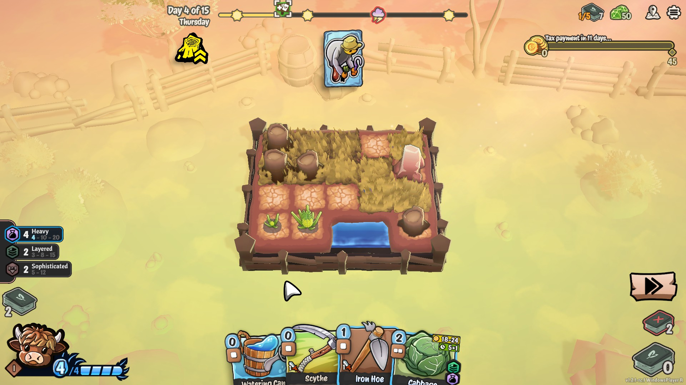
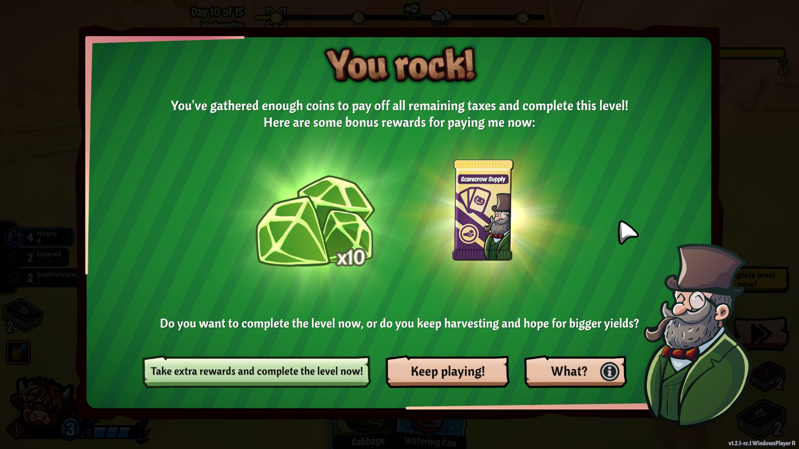
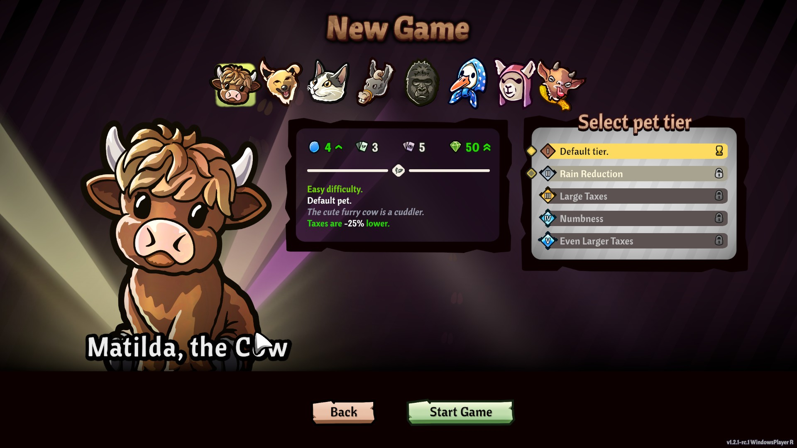
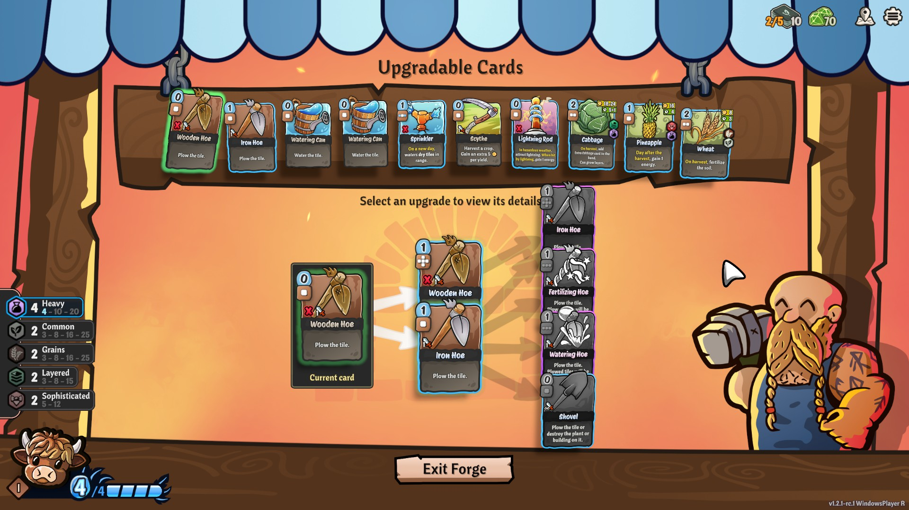
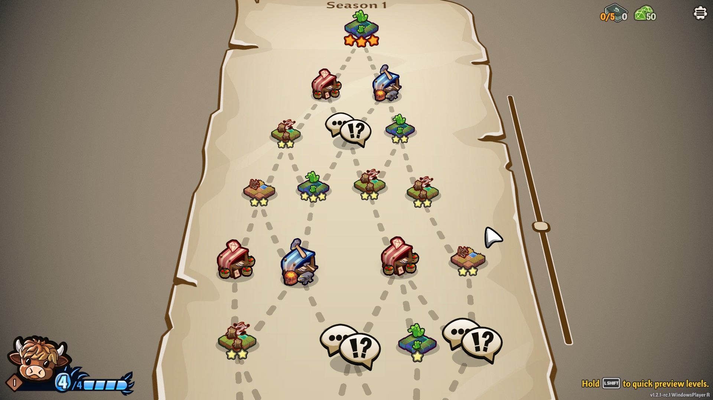
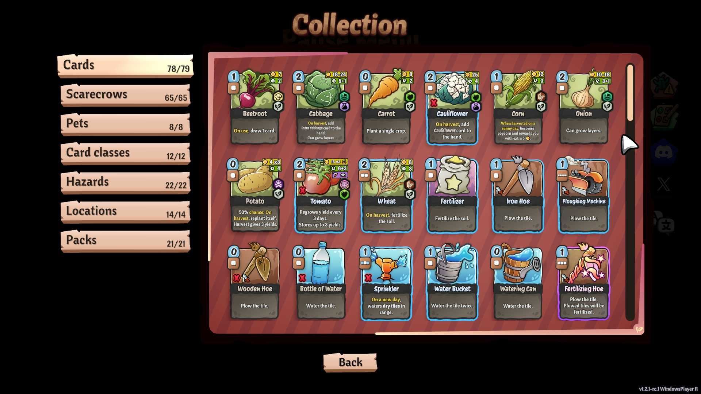

# Cropdeck

## Overview

Cropdeck is like Balatro, except that you grow crops instead of playing poker hands. There are scarecrows instead of jokers. Rather than score chasing, you need to sell enough crops to pay rent. You go through a Slay the Spire type of map with various challenges, and if you can complete the full map, you move on to the next season. Complete three seasons to win the run!

## Gameplay

You have a certain number of days to work the fields before rent is due. During this time, you plant crops, water them, and build items that will help you with your harvest. When the crops are grown to your liking ("fully grown" meaning max, but some can be harvested before then), you sell them and get money, which of course goes to rent.

You can choose to keep playing the level until the end of the timeframe, which is only helpful for chasing unlocks and achievements (I definitely clicked the `What?` button). You get a bonus for finishing early, which is usually what you want to do.

Your "pet" (the player character, as far as I'm concerned) determines your hand size, number of scarecrows, and energy per turn. These have different strategies as well as Slay the Spire-esque ascension levels, which I haven't touched and don't plan to. I find the difficulty level pretty good as-is, for a casual player. If you want a challenge, turn on the difficulty modifiers.

Between stints on the farm, you can upgrade your cards at the forge, buy stuff at the store, and encounter random events. Upgrading is neat - you can spend a boatload of gems to upgrade a single card, or you can combine two of the same card for a reasonable price. Plus combining them thins your deck, so it's doubly convenient.

Finish the map to complete a season. If you beat three seasons, you'll get a chance to enter endless mode, which is basically a way to grind for unlocks and achievements. There's no reason to do it otherwise, which isn't explained particularly well.

Things you do will unlock new cards, scarecrows, pets, fields, etc. They're all pretty achievable except that tumbleweed one. Lots of fun new things to discover!

The tutorial is pretty good, although it takes a lot of practice to get used to how things work. Lots of factors at play, including weather effects, crop harvest effects, scarecrows, bonuses from collections of cards in your deck, etc. But somehow it all works together in a delightful way.

## Favorite Parts

- The animals are cute and have unique playstyles.
- The tooltips are very helpful.
- The letters from the landlord are fun.
- Solid gameplay loop.
- The collection tells you how to unlock new cards and how close you are to that. Very nice UI.

## Areas for Improvement

- It took me a while to understand that the mouse wheel was NOT scrolling through a list of starting decks, but rather rerolling them. It looked like the list might scroll, which is why I tried it. That was confusing to me, but I get it now.
- There are certain tile colorings that make them look like watered tiles when they are actually grass-covered.
- I think either my mouse or the game is hyper sensitive to location/scroll wheel changes? Sometimes I have trouble rotating an item because it often thinks I've scrolled twice, or have trouble placing cards properly because when I click to place, it thinks I've moved the mouse (which might happen because of the force of the click) so things get misplaced easily. An "undo" button might solve this.

## Target Audience

The game is very cozy, so casual gamers will love this!

Competitive gamers will enjoy getting some of the very difficult achievements.

## Summary

If you want a non-poker Balatro-style game, with pets, this is for you!

## Store Link

[Cropdeck on Steam](https://store.steampowered.com/app/3500680/Cropdeck/)
