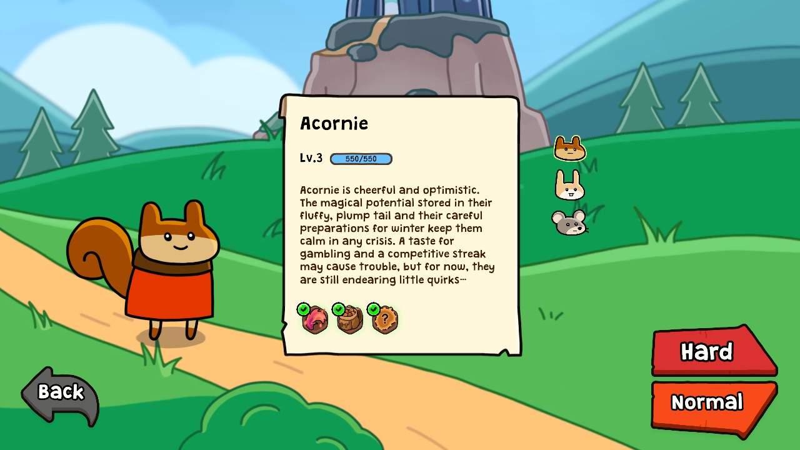
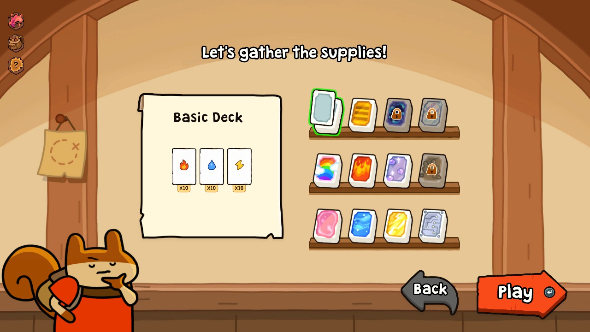
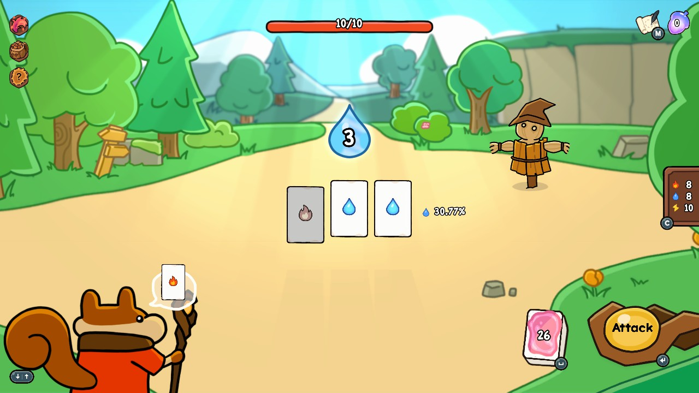
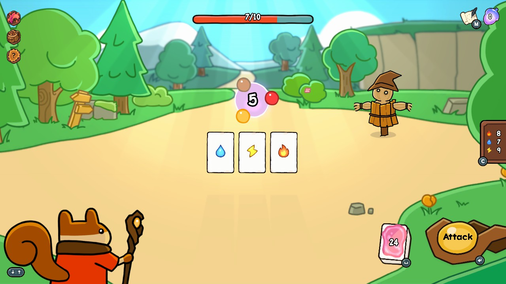
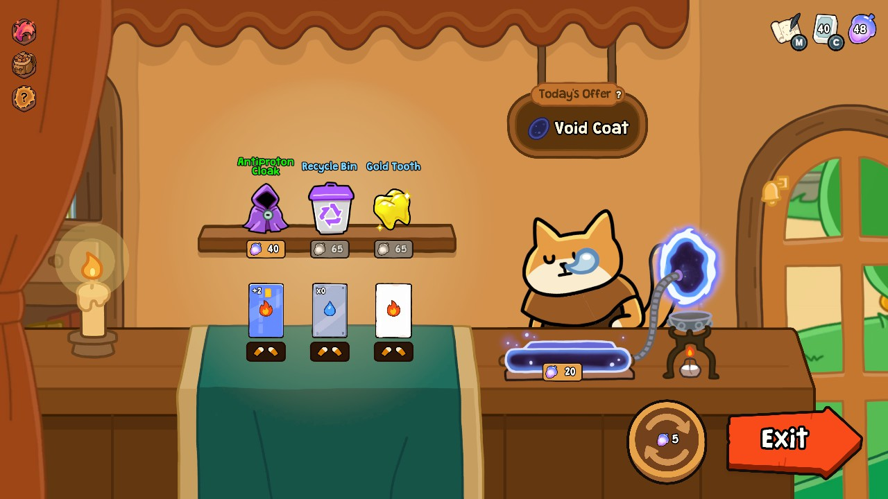
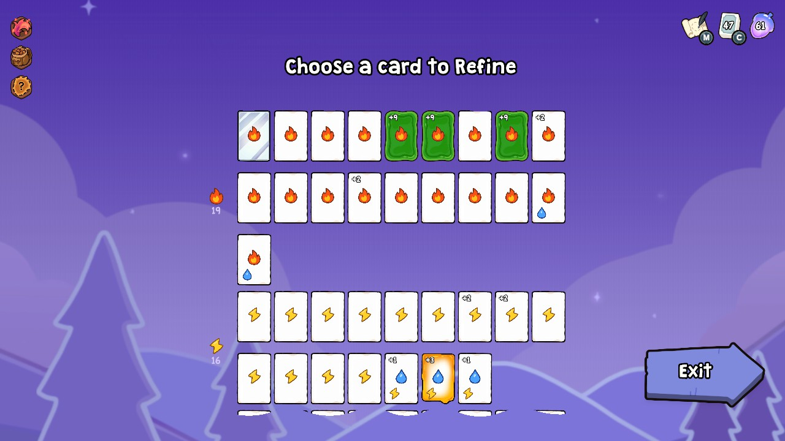
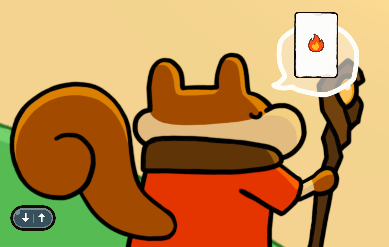
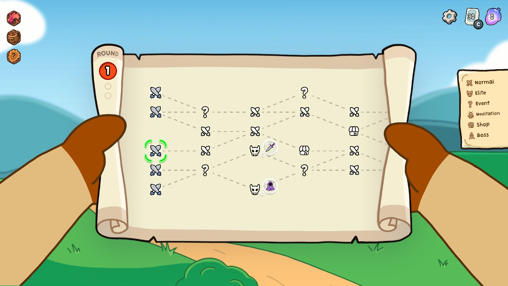

# Elementail

## Overview

Elementail is a **cute** cross between Balatro and a push your luck game. Your enemy has an amount of hit points. You have a deck. You make attacks from sets of the cards in your deck. Defeat your enemy before your deck runs out!

## Gameplay

Choose your character and starting deck. These will influence your play style. Play more to unlock new ones!

The tutorial explains the basics. Combine cards to form groups of either one of each element, or multiple of the same element. Attack when you're ready. Draw as many cards as you'd like, but only one attack per hand is possible. The other cards get discarded. Kill your enemy before you run out of cards.

There are three elements - fire, water, and electricity. There is also a stone type of card, which is similar to a wildcard, but can only be used to help with the "one of each" group attack, and only one per group. It will not help augment a single-element attack. If multiple are used together, it forms its own kind of elemental attack.

Spend acorns at the merchant, or just steal a card. The merchant offers a coating service, which can be helpful.

Meditation allows you to buff the cards in your deck, with a slight chance for a downside. Meditate often!

The puffcheek is adorable. You can use it to either save a group of cards from an unwanted card, or keep a powerful card "on hold" until the time is right. All characters have access to puffcheek.

Traverse the map, improve your deck, collect artifacts, and find ways to defeat the bosses!

## Favorite Parts

- The character art AND SOUNDS are sooooo squeaky cute.
- The cards are so simple and yet the strategy still eludes me. My favorite kind of game.
- The game seems to make fun of itself, knowing you're going to want to keep drawing.
- Pretty simple keyboard controls for MOST of the game (I still had to use the mouse for some things).
- The percentage of same-element cards remaining in your deck is shown while crafting an attack. The amount of remaining cards of each element are displayed on the right side of the screen, which I reference all the time.

## Areas for Improvement

- I still have no idea how damage is calculated for same-element attacks.
- The game launches in Korean. Don't be scared! Just click on the settings (gear icon when you hover over it) and change the dropdown to English. It would be nice if it set the language on first launch based on your Steam or OS language.
- It took me a long time to figure out what the stone icon was.

## Target Audience

It's a cozy, casual game. Of course, Hard mode is bound to be harder, but competitive folks are probably not the target audience here.

## Summary

This game is kind of like a cozy combination of Balatro and a push your luck game. It's not too brutal, and also not too long. Lots of replay value and it's cute and fun!

## Store Link

[Elementail on Steam](https://store.steampowered.com/app/3839890/ELEMENTAIL/)
