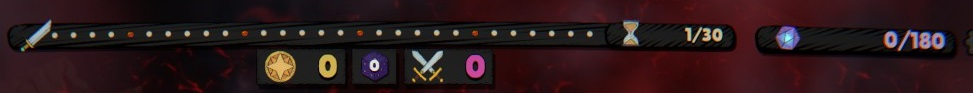
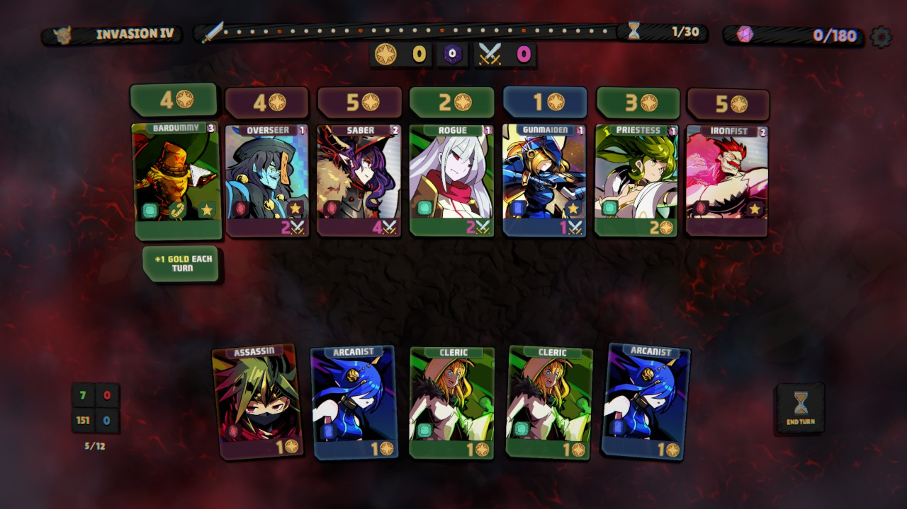
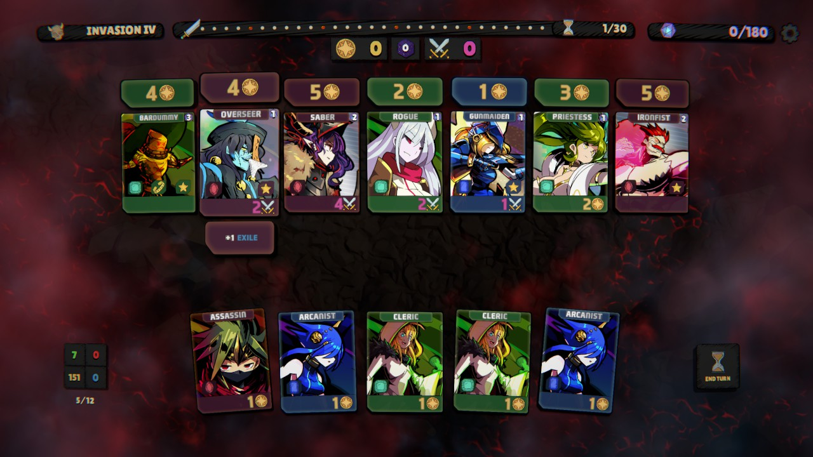
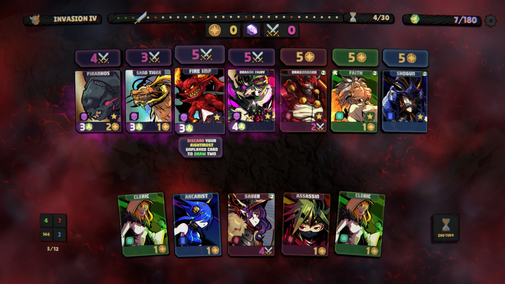
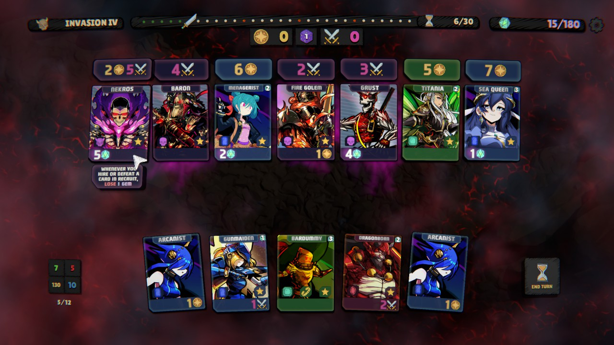
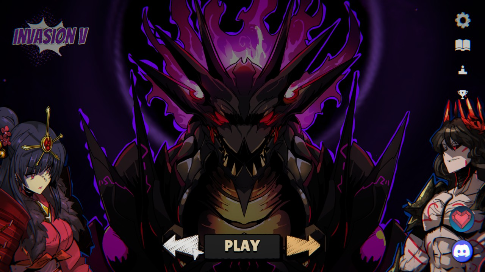
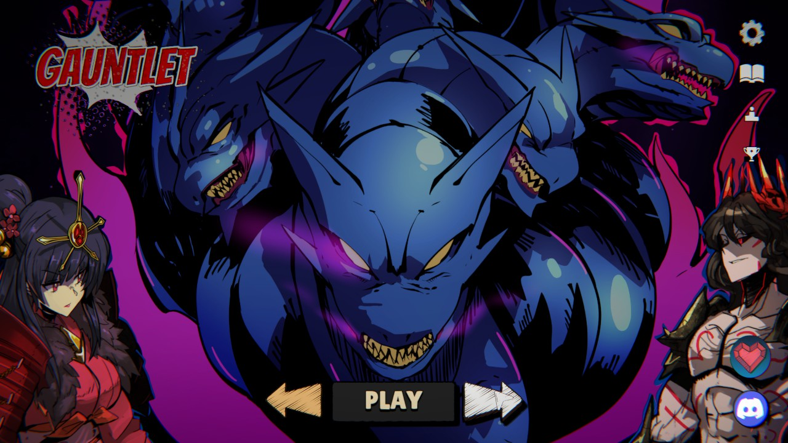
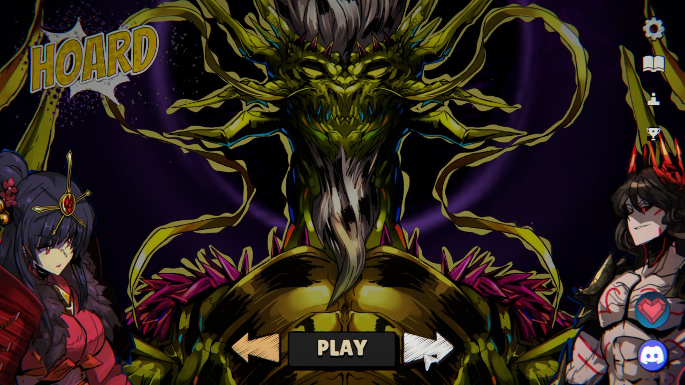
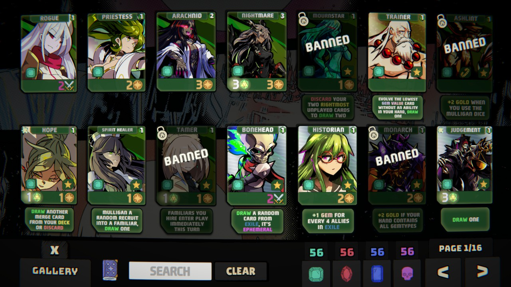

# Gemblades

## Overview

Gemblades is like playing a deckbuilder board game without other players taking the cards you want! You use gold to buy cards that improve your deck, and use power to defeat enemies. Collect enough gems and defeat all the bosses before the turn limit to win!

## Gameplay

As in most deckbuilders, you have a starting deck of cards that give you 1 gold. You start with 5 cards in your hand. Play any number of cards from your hand each turn and use the resources you get from them to defeat monsters and buy more cards to improve your deck. It is also important to exile cards from your hand in order to have a better chance of drawing your more powerful cards each turn. When you buy a card, it goes into your discard pile. At the end of the turn, discard your hand and draw back up to 5. When the deck is exhausted, you shuffle the discard pile and it becomes the deck.

You need to collect a certain number of gems and defeat all bosses before the turn limit to win. Gems come from cards you buy as well as enemies that you defeat.

There are a few types of cards.

### Familiars

Familiars are like Powers in Slay the Spire. They stay in play and affect each turn.

### Allies

You can hire allies from the recruit row at the top. They will go into your discard pile and you can play them to gain resources or effects for that turn. You get their effect when you play them.

### Enemies

Enemies can be defeated by having the required amount of power. Defeated enemies are exiled. They often give rewards in the form of gems or gold, and may have other effects that trigger when they are defeated.

### Bosses

Bosses show up at certain turn numbers as shown by red dots on the turn track. They often have powerful abilities. In Invasion and Gauntlet modes, they should be defeated as soon as possible. All bosses must be defeated in order to win.

## Game Modes

The tutorial is called "Invasion" and there are 5 levels. It teaches you how to play and gives you some practice before diving into the deep end.

Then comes Gauntlet. You play all 5 rounds of Invasion sequentially with a much lower turn limit. It is difficult!

After Gauntlet is Hoard. It's more like a puzzle, where the boss gets more powerful with each gemblade hired and each enemy defeated. The turn limit is low and the gem threshold is very high. I haven't figured it out yet, but it is fun regardless. Very difficult!

## Hidden Aspects

There are a couple of more advanced things to do, which are not well explained if mentioned at all.

### Merging

There are certain sets of cards that combine if they are all in your hand at once. This is mentioned briefly in the tutorial, but never really explained. There is a help option in the menu, which lists two of these sets. However, this does not seem to be exhaustive and there are other sets. I have gotten a merge only by accident, as the set I completed is not listed in the help menu.

### Banning

You can go to the collection and click on cards to ban them, which prevents them from showing up in the recruit deck. This is very important if you want to play Gauntlet or Hoard modes.

## Favorite Parts

- The core gameplay is solid. Really feels like playing a solo board game.
- The art is unique.
- The cards are easy to understand.
- The tutorial is pretty good. There are difficult modes for those who want a challenge.

## Areas for Improvement

- The difference between allies, gemblades, and recruits is never explained and takes a while to understand.
- The options menu "sliders" are very difficult to use. Dragging the slider does nothing. Clicking on the other side to change it does nothing. It actually functions more like a checkbox, where you have to click the slider itself without dragging in order to toggle it.
- The numbers in the bottom left corner are strange. The four in the box have tooltips, which are fine, although weirdly placed. The numbers above and below the box have no explanation at all, and are very difficult to figure out. The bottom numbers are `cards in hand` / `max hand size`. The top numbers are `familiars` / `max familiars`. Why are all of these numbers not placed closer to the relevant part of the board?

## Target Audience

Casual gamers will enjoy Invasion mode and probably venture into the other modes to give them a try.

Competitive gamers will love min-maxing this game and playing Gauntlet and Hoard modes. They'll also love fighting over the leaderboard spots.

## Summary

If you enjoy deckbuilder board games, give this a try!

## Store Link

[Gemblades on Steam](https://store.steampowered.com/app/3165590/Gemblades/)
