# Hungry Horrors

## Overview

Hungry Horrors is a roguelite where instead of fighting monsters, you feed them! No killing necessary here. Just give them enough food to eat, and they'll leave you alone. Just hope that they like your cooking!

## Gameplay

You are the princess. You are waiting for your prince. Of course, things don't go according to plan. You have to learn to cook in order to appease monsters invading your kingdom.

In the castle, you can cook dishes you have learned to create your starting deck. You can also season dishes, set a starting artefact, change familiars, and change your appearance here once you've unlocked these abilities.

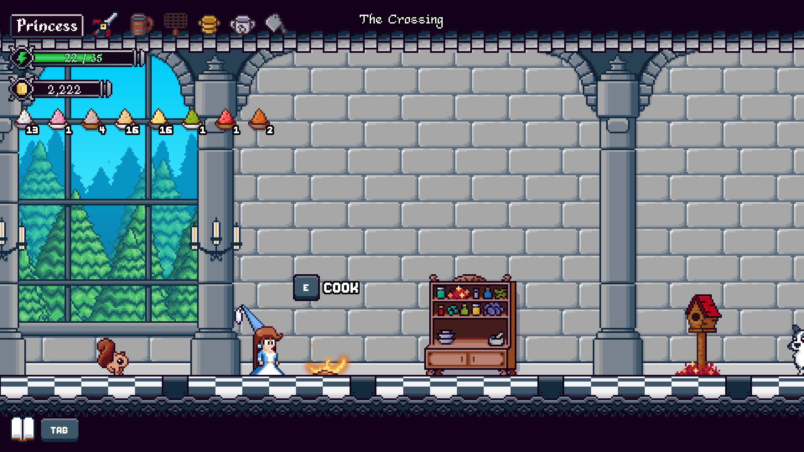

Then you choose a door. Which area will you explore and feed its monsters?

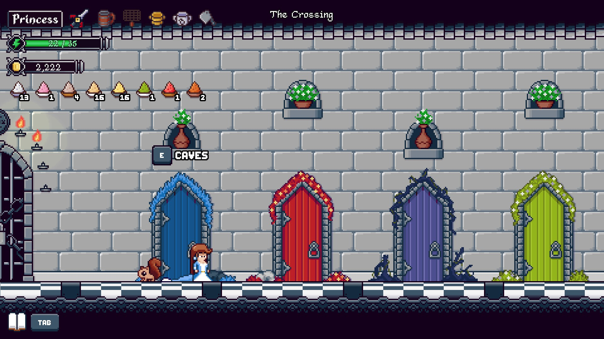

Inside the door, you will find many monsters. You must feed them based on their food preferences. Beware an angry monster who **HATES** your dish! You can also "cycle" (discard and draw) some number of free times, and then at the cost of your stamina. Monsters will attack you or move forward. Their attacks do various things, often reducing your stamina. Don't let your stamina drop to 0, or it's a gruesome yet still cute death scene. If they reach you, well, enjoy the death scene.

Your goal is to satiate their hunger before they reach you (or otherwise kill you). Each dish will have a hunger value. But the real key is the cravings chain! Feed them what they want to eat each turn, and you'll get a bonus for each dish you served them earlier in the fight. Pay attention to their craving, and their likes and dislikes.

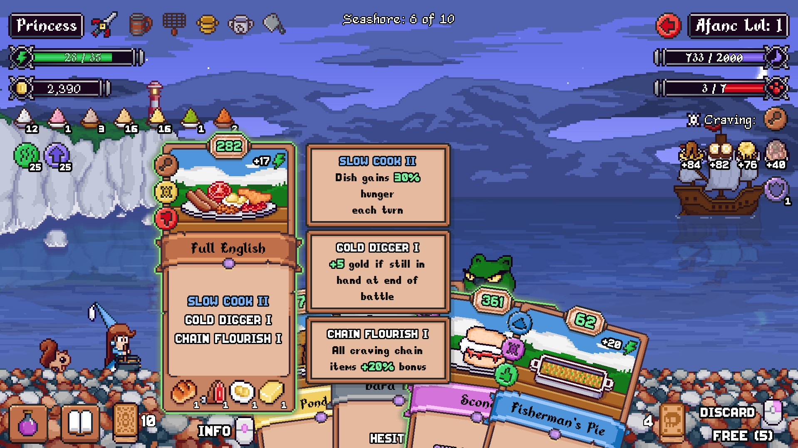

You can buy helpful items and new recipes at the shop!

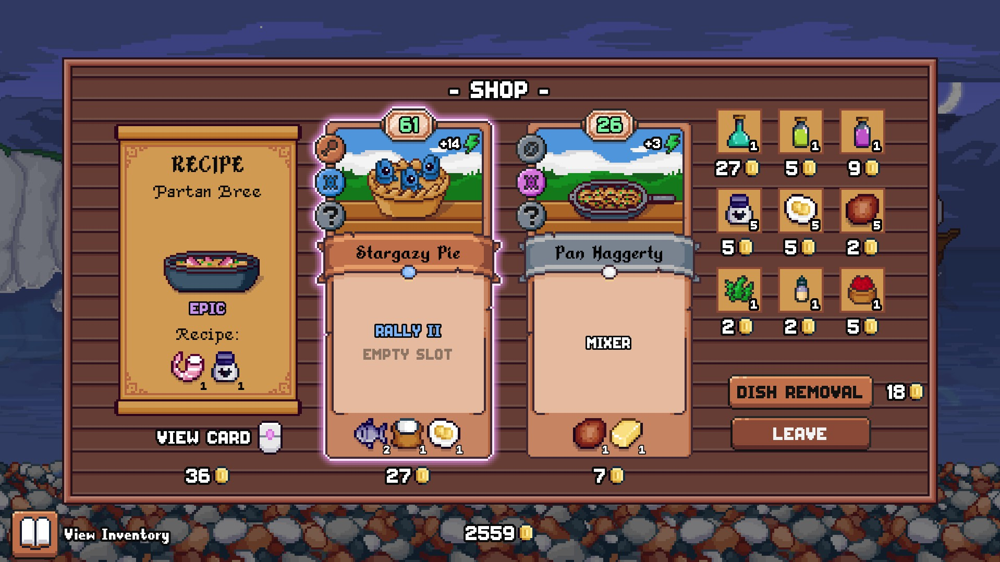

You can also read about the lore.

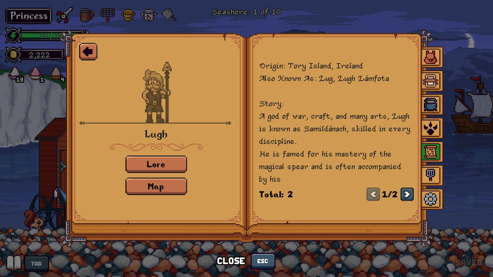

## Banquet Mode

In addition to Story Mode, which is described above, there is also Banquet Mode, which is more of a roguelike style of play.

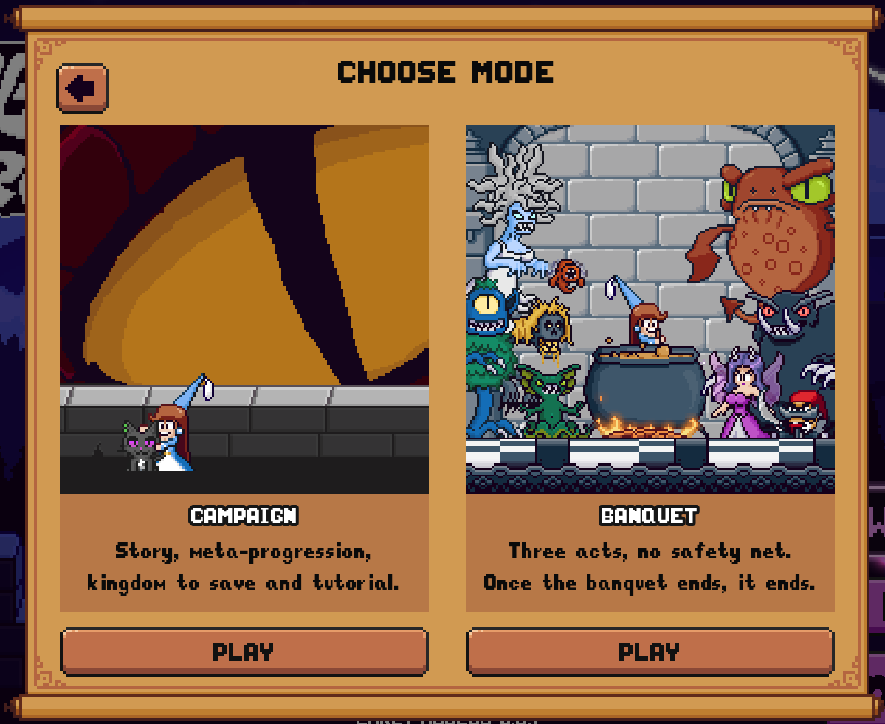

There are a bunch of options in setting up a run in Banquet Mode.

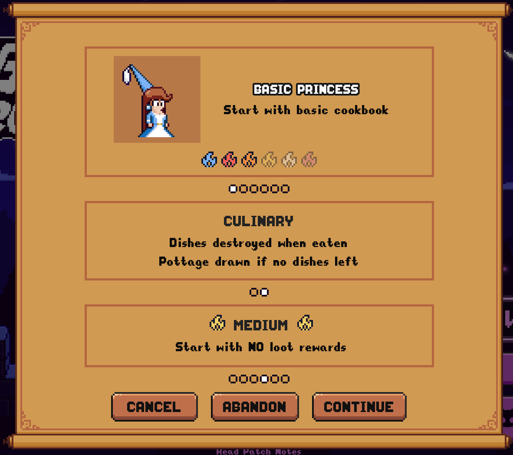

### Princess

You can choose between multiple princess types. The basic one has no rules modifiers. Others tweak the rules or change the gameplay style. Beat a Banquet Mode run with one princess type to unlock the next one!

### Deckbuilder or Culinary

You can choose which style of gameplay you would like.

- Deckbuilder - What you would expect from this game. Your focus is on building a great deck! When you feed monsters or serve the dish to yourself to heal, the dishes go to the discard pile, and are shuffled back into your deck when it runs out.
- Culinary - When you feed a monster or yourself, the dish disappears from your deck PERMANENTLY. To counterbalance this, the monsters drop ingredients of increasing amounts as you proceed in your run, and you have the option to cook after each encounter (both combat and non-combat).

### Difficulty

You default to Raw difficulty, which has no rules modifiers. As you beat each difficulty, another one unlocks, adding in a new challenge (it doesn't get any easier).

- Raw
- Rare
- Medium Rare
- Medium
- Medium Well
- Well Done

## Favorite Parts

- The lore is wonderful. You can read all about the monsters and events.
- The death scenes. Let's just leave it at that.
- The attitude of the princess. Enjoy the dialogue and the "bored" animations!

## Areas for Improvement

- In the Deckbuilder Banquet mode, Stinky Princess modifier creates unintended horror move loops. There was a balance patch to prevent exponential hunger gains, but it likely still needs adjusting. This is planned for after 1.0.

## Target Audience

Casual gamers will enjoy story mode, as it gets easier the more you play it and unlock and collect items and buffs. The fights are not unbeatable, though you may have to use some consumable items.

Hardcore gamers will find vanilla story mode a bit too light and fluffy (enjoying my food puns?). There is now a "spicy" mode which is harder than the vanilla game, which might satisfy their desired level of challenge. For a more traditional roguelike experience, there is Banquet mode with multiple difficulty and princess modifiers. Culinary mode is particularly difficult for those who want it.

Everyone will enjoy the lore and characters!

## Summary

If you enjoy British and Irish folklore, or food, get this game! It's a cute non-violent roguelite. And if you still need another reason to get this, you can pet the cat, dog, and your familiar.

## Store Link

[Hungry Horrors on Steam](https://store.steampowered.com/app/3048840/Hungry_Horrors/)

## Bonus Section - Banquet Mode Guide

I was asked to create a guide for banquet mode, so here goes!

### Choose Your Banquet

This assumes you've already played at least some of the story and understand the rules. Choose Banquet Mode.

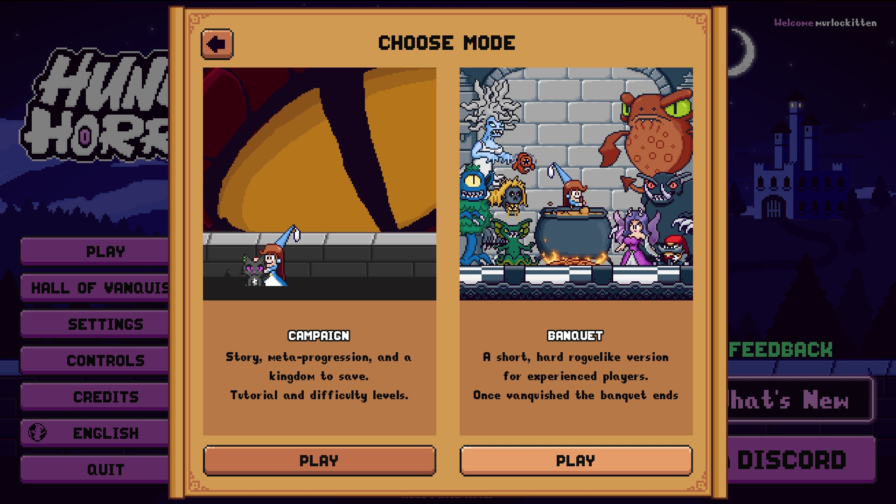

Next, choose your modifiers. I have lists up above, so either reference them or just flip through the options. New princesses will unlock as you win banquet runs (ex. beat Basic Princess to unlock the next one). The difficulty cannot be increased until you defeat the base difficulty for that princess and mode.

For example, here I'm choosing the Clumsy Princess (discard a card each turn) in Culinary mode (dishes are removed after eating or feeding) on Raw (default) difficulty.

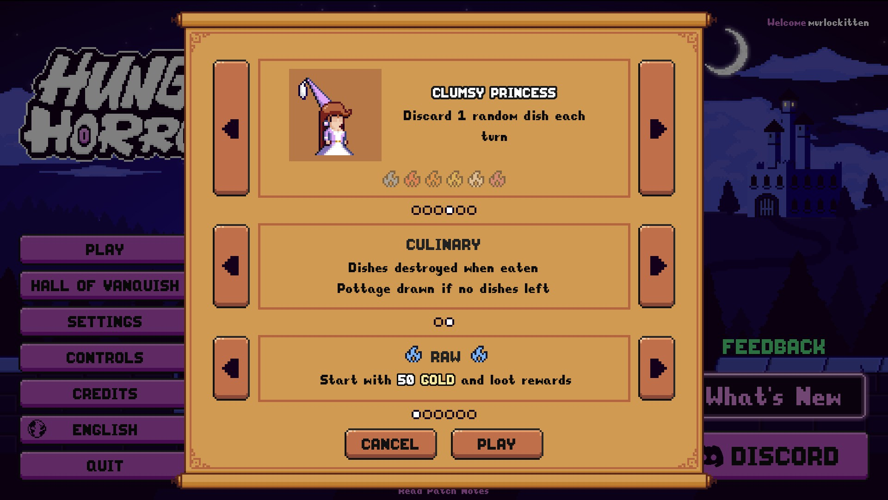

### Setup

Now we get to build a starter deck. For all princess types except Random Princess (where you get random recipes to start), I recommend building a starter deck of three or four types that chain into each other. In Culinary mode this is particularly important because the cravings chain is the ONLY way you'll survive before you run out of dishes, so every dish needs to work together. Here's an example of a non-random starter deck. I include one non-chain dish for healing, because it stays in hand and therefore won't be removed in Culinary mode.

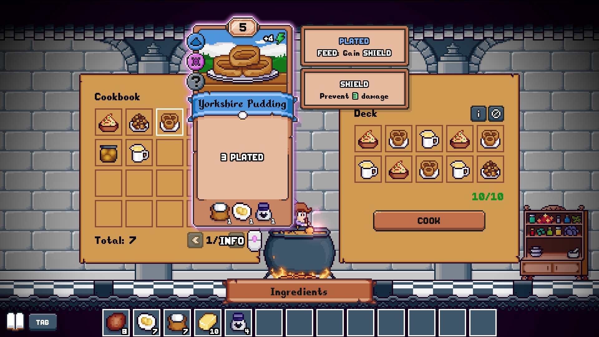

In all Banquet mode runs, you get only 3 biomes, and you don't choose them. One is "starter", one is "main course", one is "dessert", and the difficulty increases as you go. Beat the first one to unlock the second door, and beat the second biome to unlock the third door.

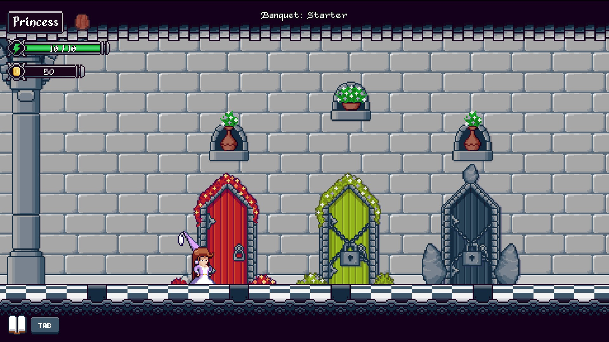

You will be able to see the horrors' food preferences (love, like, dislike, hate), so no need to worry about discovering their tastes. That doesn't mean it will be easy though! `^_^`

### Strategy

In Culinary mode, the horrors will drop increasing amounts of ingredients, and you get a chance to cook after each battle. This is extremely important to do, as your deck is destroyed as you eat dishes or feed horrors. You have to constantly replenish your deck, hopefully with better dishes as you go. The rarer ingredients will drop in later biomes and battles. Prioritize encounters that reward you with ingredients or recipes, as they are the most important rewards for Culinary mode. It seems like a good idea to take dishes, but remember, they are removed as soon as you use them, so they're not a great choice of reward. Neither are seasonings, as the seasoned dish will have only one use.

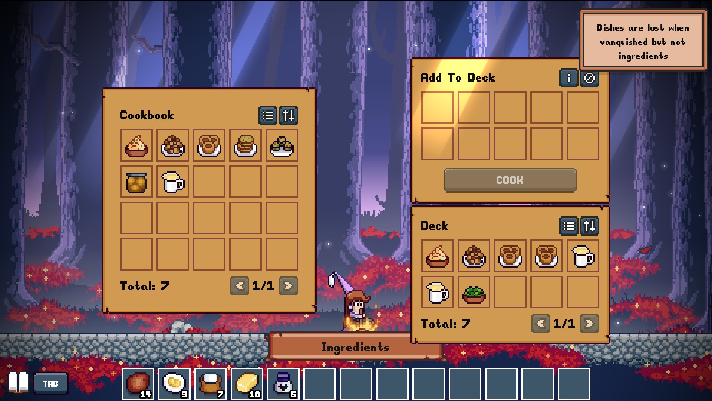

In Deckbuilder mode, try to find as many new dishes (not recipes!) as possible. This is how you will improve your deck. Feed Faelinis. He loves it, and removing weaker dishes from your deck will ensure you draw your best dishes more frequently. Recipes and ingredients are not good rewards for this mode because you have so few opportunities to cook and the likelihood that your recipes and ingredients match is low, so avoid them both if possible.

In both modes, potions are a solid reward category. Gold is ok depending on your vendor needs, but not something to be prioritized in choosing rewards.

I would recommend taking at least one elite battle in the first biome in order to get a second cookware. You'll receive another cookware at the end of the biome, so that will max you out at three cookware. It can be difficult in culinary mode because you might run out of dishes, so choose it at a time that you feel confident in your deck (and not running out of dishes or ingredients).

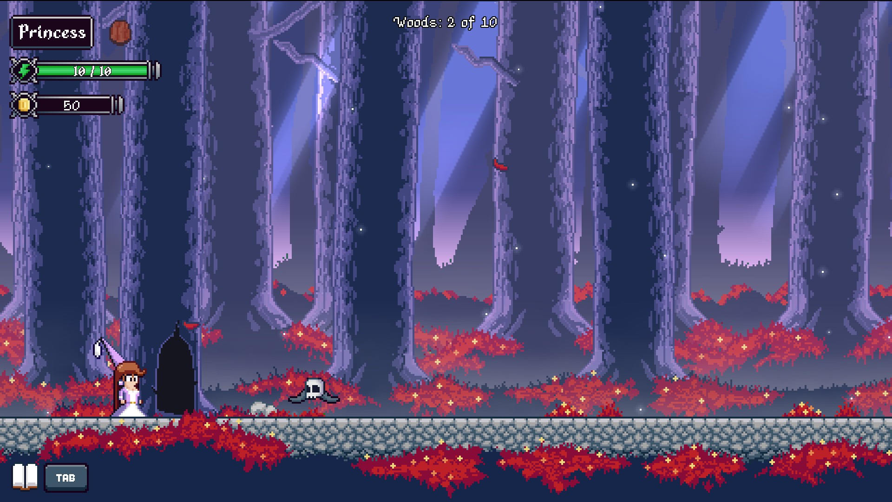

You'll get Scrolls of Taliesin that you can use between biomes to gain bonuses, so make sure you use them!

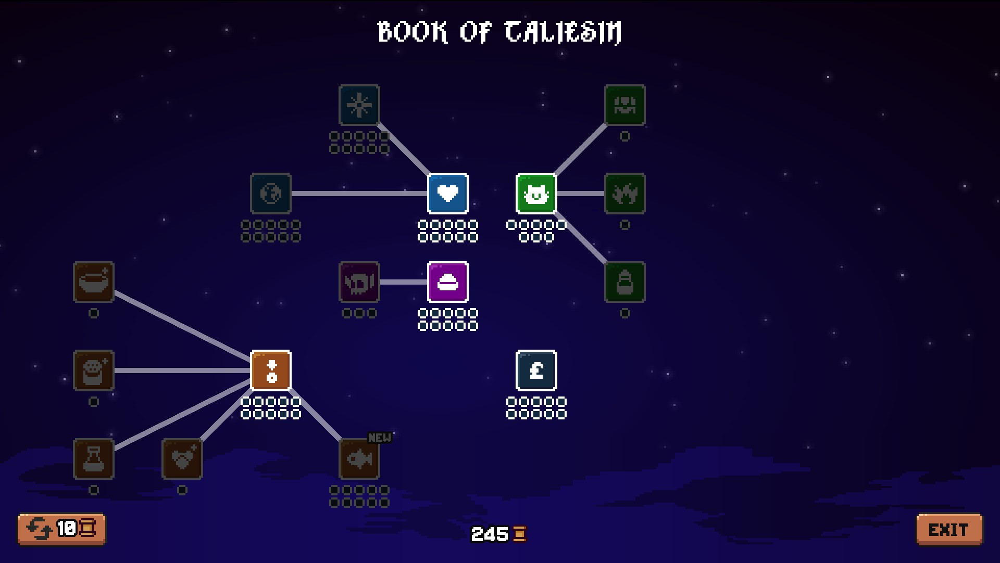

As you go, remember to improve your deck. In deckbuilder mode this means picking up stronger dishes and removing weaker ones. In culinary mode this means cooking better dishes after each battle and ensuring a steady supply of ingredients to make them.

This is the roguelike experience you've been craving, pun intended. Good luck!
