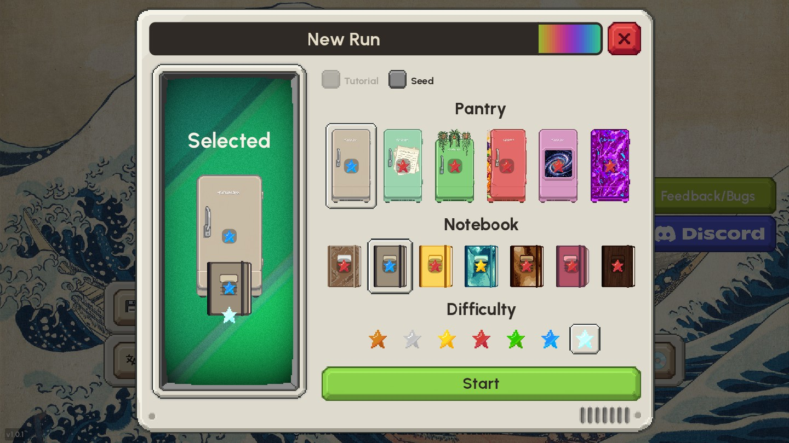
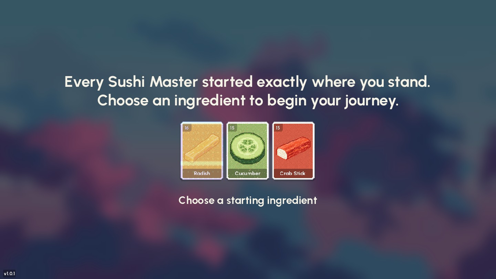
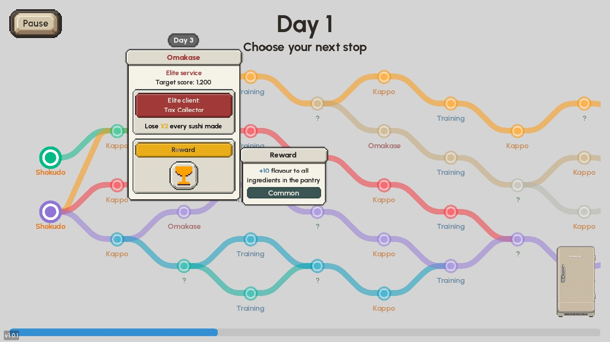
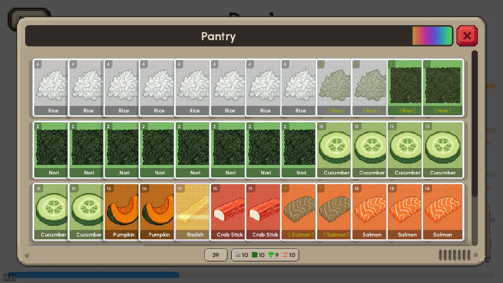
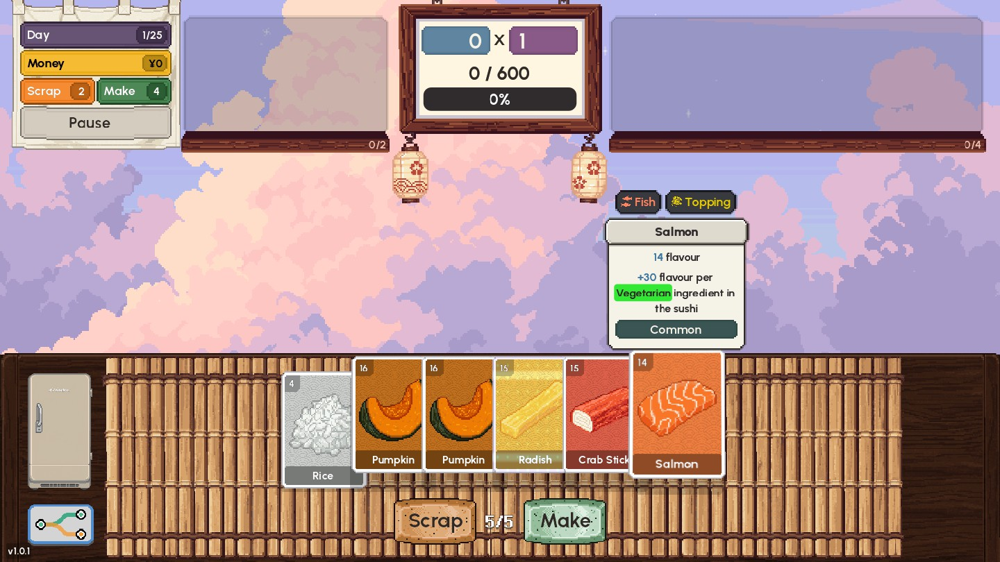
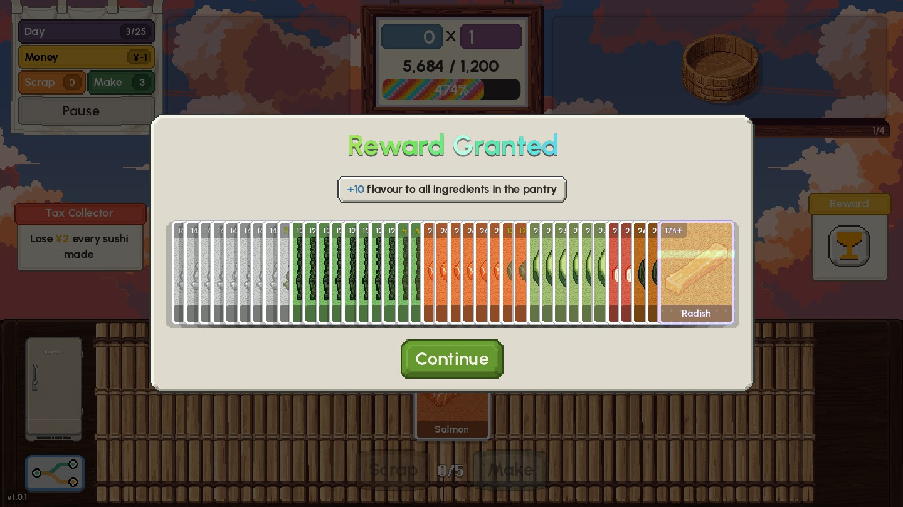
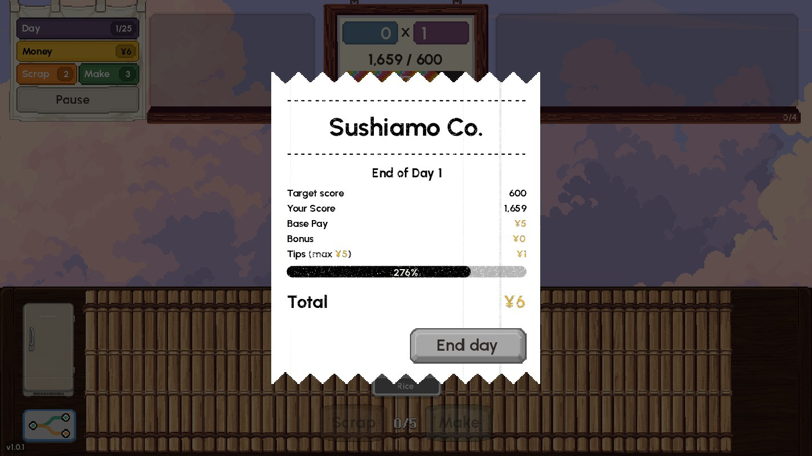
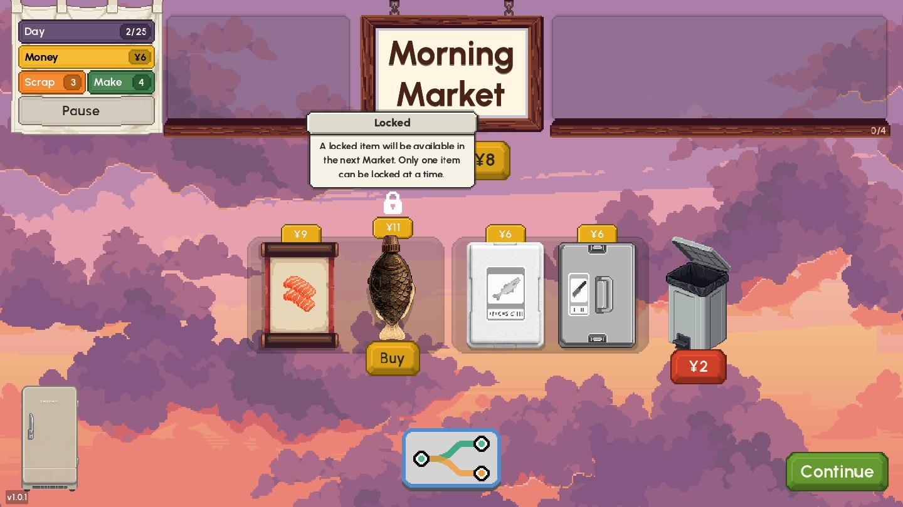
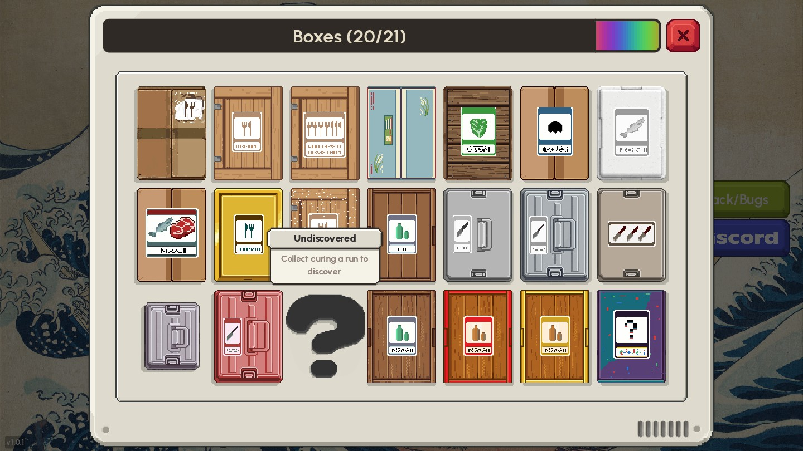
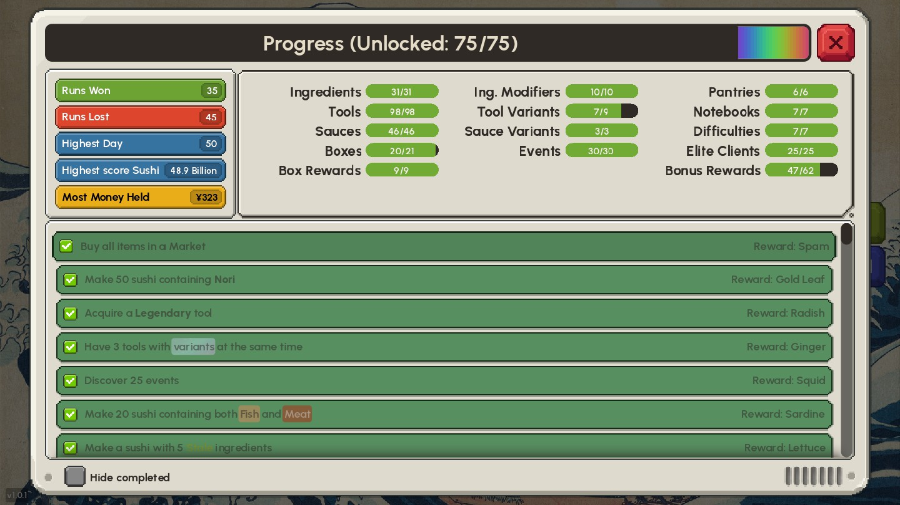

# Sushiamo

## Overview

Sushiamo is a Balatro style game that's much gentler for newcomers to the genre. Instead of Jokers, you have tools and sauces. Instead of making poker hands, you make "sushi" with ingredients from your hand. Your deck is your pantry. Chase the score target and make something delicious!

## Gameplay

You start a new game by choosing your pantry, notebook, and difficulty level. At first, only one of each will be unlocked. As you play, and win, you'll get more options.

On your first playthrough, which is the tutorial by default, you'll get started right away. If it's not the tutorial, you'll choose an ingredient to add to your pantry (deck).

You'll find yourself on the map. This is similar in style to Slay the Spire, but themed like a Japanese train map!

- Shokudo - the first meal. You start here.
- Kappo - normal service. Make sushi in order to hit your target score.
- Omakase - elite service. The score requirement is the same as if it were a normal service, but there is a twist based on the client, and you get an extra reward.
- Unknown - this can either be an event or an omakase.
- Training - your base hype will be increased (yay!).

During a kappo or omakase, you will need to use the ingredients from your pantry to create sushi. You can check your pantry by clicking on the refrigerator.

Ingredients can have up to one quality and modifier each. I won't list them here to avoid spoilers, pun intended. As you play, you'll discover these and how they affect your flavour and hype, but be aware that you will start with some stale ingredients on your first tutorial run. They only score half flavour, so be careful!

Select some cards in your hand and choose one of the two basic options - **make** or **scrap**. You can select up to 5 cards at a time by default, although there are tools, notebooks, and modifiers to change this. Make uses the ingredients in sushi and scores them against the score target. Some ingredients might go well with others, so plan ahead! Scrap discards them and draws new ingredients from your pantry. If the pantry is empty, it will be restocked (reshuffles the deck). To score, you multiply the flavour from your played ingredients by the hype, as shown at the top center of the screen. You only have a limited number of make and scrap each day, so you have to hit the target score before you run out of make.

Remember that omakase give you an extra reward at the cost of a difficult client. It might be worth it!

If you hit the target score, you will see a receipt with a summary of your scoring and payout. By default, you get $5 (they use yen but honestly that's just for flavour, pun intended. It makes no sense money-wise). If you have any cards or tools or sauces that give you extra money, that is added as the bonus. If you score high enough to re-hit the target score, up to 5 times, you get a tip for each time. All of this is added up and you get paid.

Money can be used at the market, which appears before each kappo or omakase. You can buy ingredients, tools, or sauces depending on the daily selection in the market. No matter what, you will have the options to restock (refresh the available items) and trash (see 5 random cards from your pantry and remove a card). You can also lock an item in the market, so that it won't be refreshed the next time you enter the market. This lets you save a particularly useful item for later, when you can afford it. And yes, you will always be poor.

The score will keep increasing as the days (nodes on the map) progress. Make it through day 25 to win the run!

Outside of runs, you can view your collection and progress. The collection will tell you what items you have collected so far in a run (not just seen - you have to buy/have them), and how to unlock others.

The progress screen will tell you about quests to unlock items as well as how much of certain collections you have.

## Favorite Parts

- The gameplay loop makes you crave Japanese food. **S U S H I**.
- The basic mechanics are easy to understand.
- The art and music are relaxing.
- There are some great accessibility options. I turned off the visual distortions.
- The collection shows you unlock requirements and progress bars towards completing collections.

## Areas for Improvement

- Let's be real here - some of these ingredients don't go in sushi. But ok, willing suspension of disbelief, the game is still great.
- It's hard to understand which effects are permanent and which are not. I think there's some difference between "own flavour" and "self flavour", which to me mean the same thing.
- There is some hidden information. During the run it's "luck" and "omakase reveal distance". In the collection there are some things you're trying to collect, like omakase rewards, but no way to see them or their unlock requirements.
- As far as I can tell, there is no saving during the run? There is no save indicator, at the very least, and when you bring up the menu, there is no "Save and Quit", just "Leave". As such, I haven't felt comfortable using that option in case I lose my run. So make sure you have time set aside for a run.
- When I turn off full screen, it goes to 720p, which I like. But when I quit and launch the game again, it reverts to 1080p (almost full screen), and I have to toggle the full screen option to get to back to 720p (smaller window). It should save the resolution.

## Target Audience

This game appeals to both cozy and competitive audiences. The initial difficulty is pretty easy, but there are plenty of ways to make it brutal, with choosing a difficulty setting, a notebook, and a pantry for each run. Ruby star difficulty starts to get really rough, so go for that if you like it.

## Summary

If you struggled with Balatro and love sushi, this game is for you!

## Store Link

[Sushiamo on Steam](https://store.steampowered.com/app/4555040/Sushiamo/)
